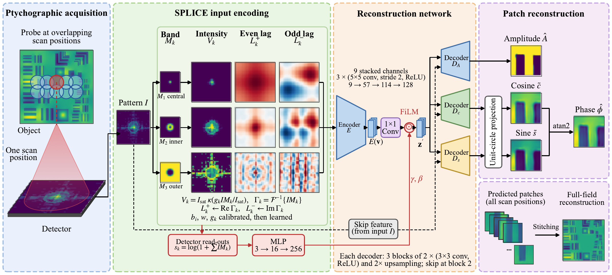

# Saturation-Aware Dual-Domain Learning for Ptychographic Image Reconstruction

<p align="center">
  
</p>

Official PyTorch implementation of **SPLICE** (Saturation-aware Partitioned
Lag–Intensity Correlation Encoding) for single-pattern neural ptychography.

Carson Yu Liu, Jun Cheng, Chien-Chun Chen, and Steve F. Shu

## Quick start

```bash
git clone https://github.com/carson-liu/SPLICE-Ptycho.git
cd SPLICE-Ptycho
pip install -r requirements.txt

python main.py --dataset ad_ltem --mode test
```

This evaluates the pretrained AD_LTEM model and writes the reconstructions and
figures to `results/ad_ltem/`. For an interactive walkthrough, open `demo.ipynb`.

## Data sources

**Simulated AD_LTEM** (included in `data/`). The object is the modified USAF chart
from [AD_LTEM](https://github.com/danielzt12/AD_LTEM), scanned with a 32 × 32 probe
at 75% overlap, with Gaussian and Poisson noise. To regenerate the data, or to draw
a new noise realization:

```bash
python main.py --mode generate [--noise-seed 1]
```

**Experimental X-ray.** This is the tungsten test-pattern scan from
[PtychoNN](https://github.com/mcherukara/PtychoNN) (APS sector 26). Download it
from [Hugging Face](https://huggingface.co/datasets/mcherukara/PtychoNN_data) into
`data/`:

```bash
for f in 20191008_39_diff_reduced.npz 20191008_39_amp_pha_10nm_full.npy; do
  curl -L "https://huggingface.co/datasets/mcherukara/PtychoNN_data/resolve/main/$f?download=true" -o data/$f
done
```

## Training and testing

```bash
python main.py --dataset {ad_ltem,experimental} --mode test
python main.py --dataset {ad_ltem,experimental} --mode train --seed 0
```

Testing uses the checkpoints in `checkpoints/` and prints patch-level and stitched
metrics. Training runs for 45 epochs, keeps the epoch with the lowest validation
loss, and writes to `runs/<dataset>/seed_<seed>/`. One AD_LTEM run takes about
7 minutes on an RTX 5080. Test regions are held out with a buffer, so no
training patch overlaps them (`datasets/common.py`). The evaluation protocol is in
`utils/metrics.py`.

## Repository structure

```text
├── main.py             # generate / train / test
├── demo.ipynb          # pretrained demo
├── checkpoints/        # pretrained models
├── data/               # simulated data (experimental data downloaded here)
├── results/            # reference outputs of the pretrained models
├── datasets/           # loaders and train/val/test split
├── models/             # SPLICE front end, network, loss
├── simulation/         # forward model and simulation assets
└── utils/              # training, inference, stitching, metrics, plots
```

Tested with Python 3.11, PyTorch 2.11 (CUDA 12.8), NumPy 1.26, and scikit-image 0.26.

## Citation

Citation information will be added after publication.

## License

MIT License. See [LICENSE](LICENSE).
